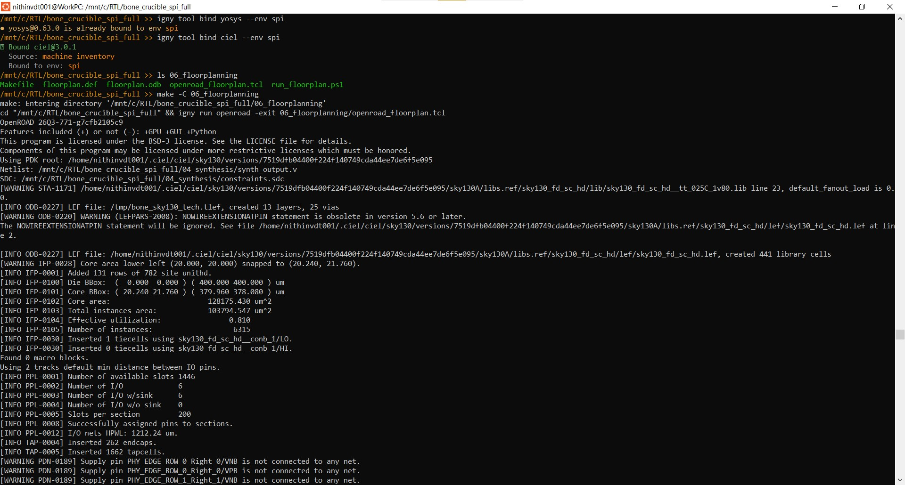
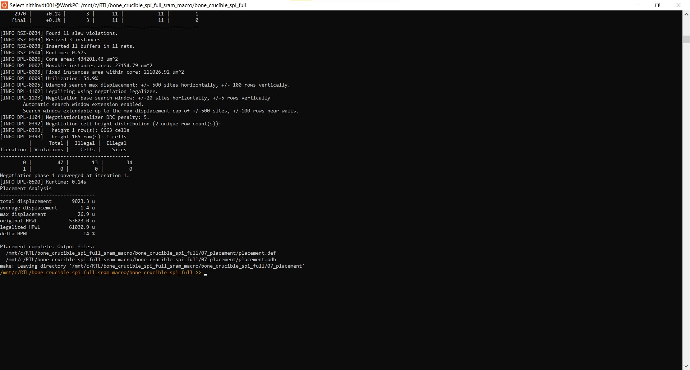
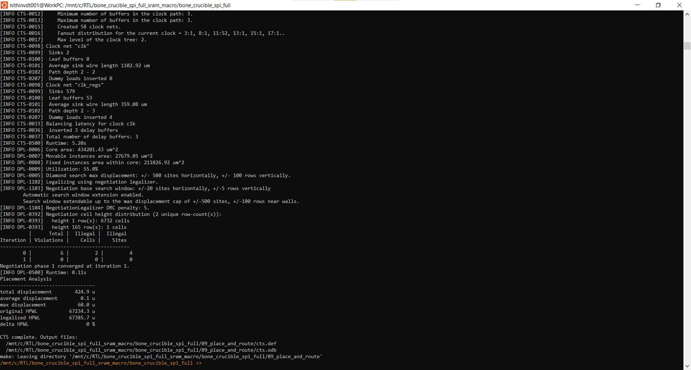
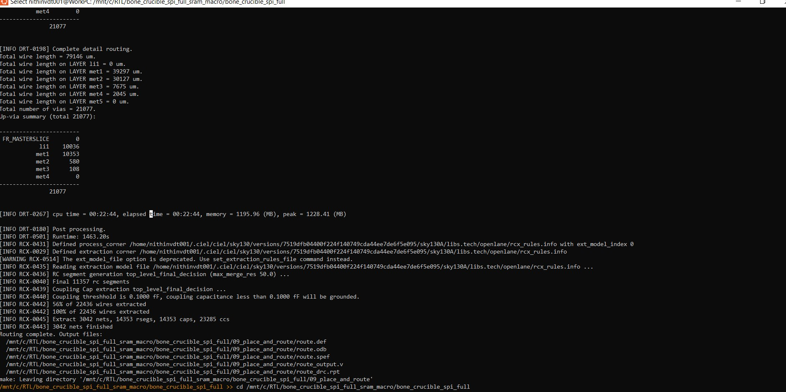
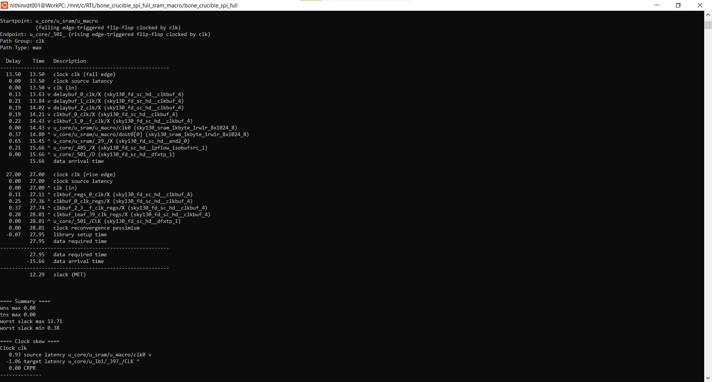

# Project gallery

A few snapshots from the project run, from lint through layout. Select an image to see it full size.

| Lint | Synthesis | Synthesis statistics |
|---|---|---|
|  |  |  |

| Core floorplan | Core placement | Core clock-tree synthesis |
|---|---|---|
|  |  |  |

| Core route-stage view | Core timing analysis | Core layout screenshot |
|---|---|---|
|  |  |  |

## Post-I/O-pad chip integration

These additional captures document the pad-integrated `chip_io_wrapper` flow. The floorplan image is the core floorplanning log used as context; placement, CTS, detailed route, STA, and the final KLayout view are from the SRAM-backed chip integration run.

| Floorplanning context | SRAM placement | CTS with SRAM |
|---|---|---|
|  |  |  |

| Detailed-route log | STA with SRAM | Final chip GDS in KLayout |
|---|---|---|
|  |  |  |

The final chip stream and its reported QoR are documented separately in [`12_chip_physical/README.md`](../12_chip_physical/README.md) and [`crucible-results/QOR_CHIP_IO.md`](../crucible-results/QOR_CHIP_IO.md). The reported metrics are not a full foundry DRC/LVS signoff. See [the flow notes](../docs/FLOW_STATUS.md) for the distinction between the original core-only route attempt and this post-I/O-integration result.

