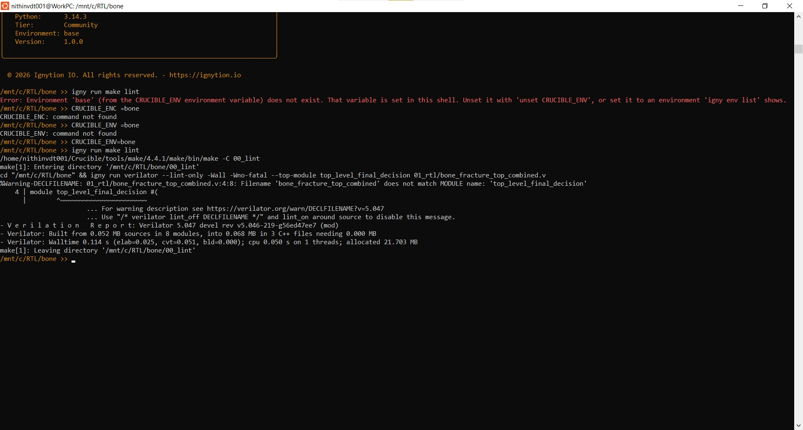
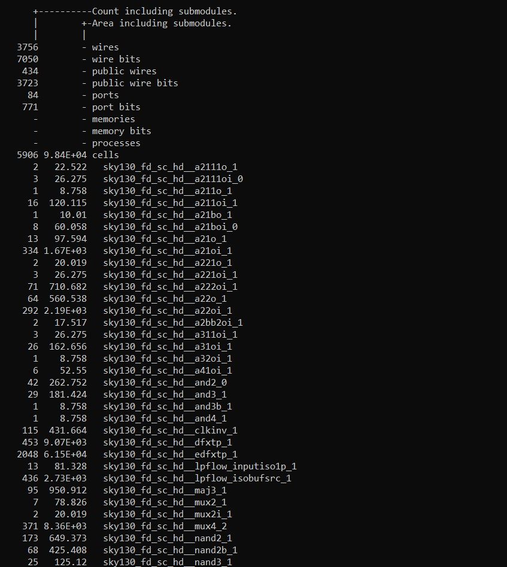
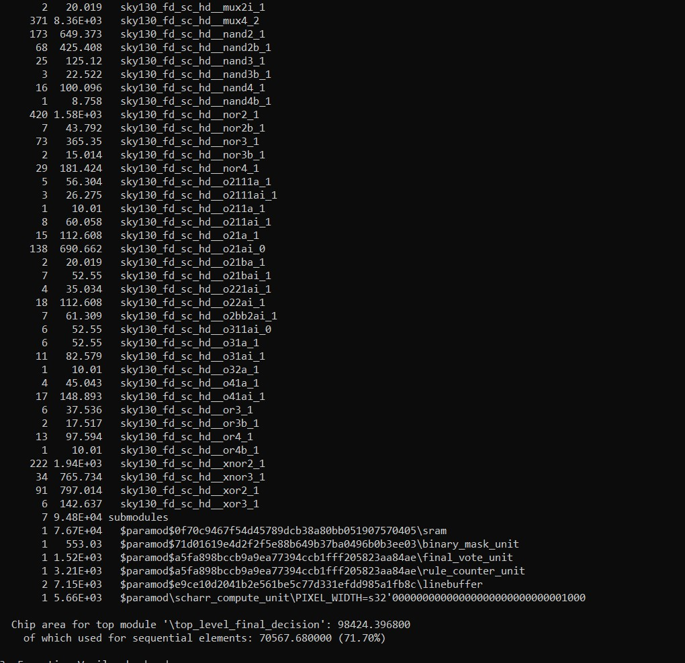
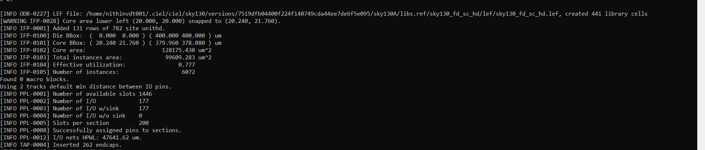
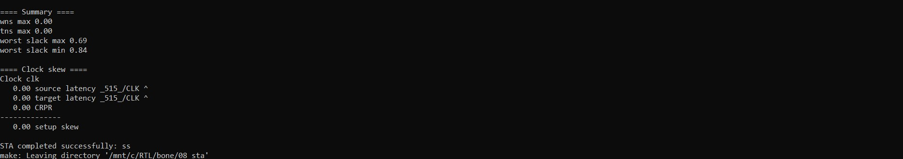
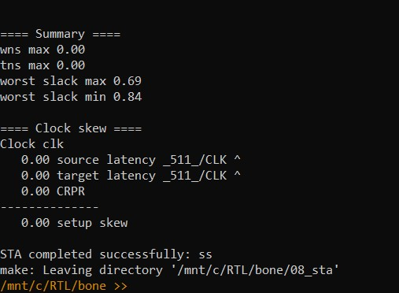
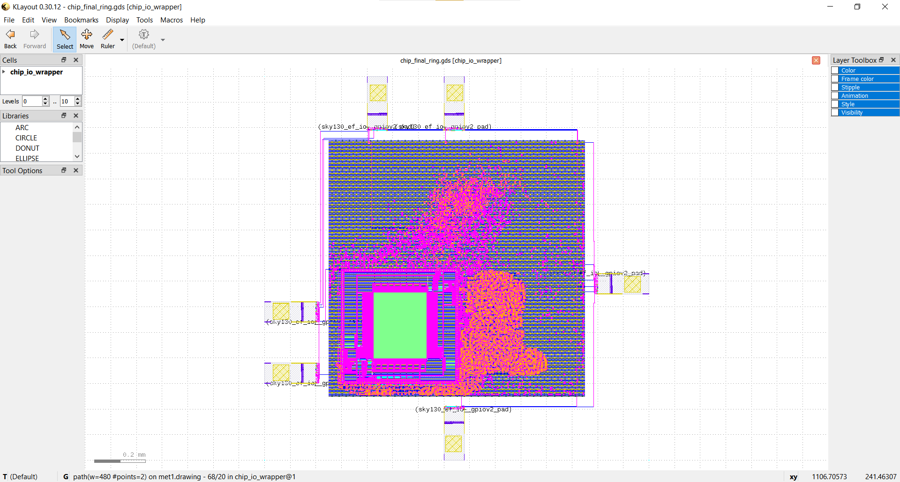

# Project gallery

## Core-flow screenshots

These earlier screenshots document the core RTL-to-GDS flow **without the SRAM macro and without chip-level I/O pads**. They are not images of the completed chip-I/O run.

| Lint | Synthesis | Synthesis statistics |
|---|---|---|
|  |  |  |

| Core-only floorplan | Core-only placement | Core-only clock-tree synthesis |
|---|---|---|
|  |  |  |

| Core-only route-stage view | Core-only timing analysis | Core-only GDS screenshot |
|---|---|---|
|  |  |  |

## Completed chip-I/O layout

This is the single supplied screenshot of the final SRAM-integrated, I/O-padded chip after detailed routing. It corresponds to `chip_final_ring.gds`; the [QoR summary](../crucible-results/QOR_CHIP_IO.md) and [run status](../12_chip_physical/STATUS.md) describe the reports.

