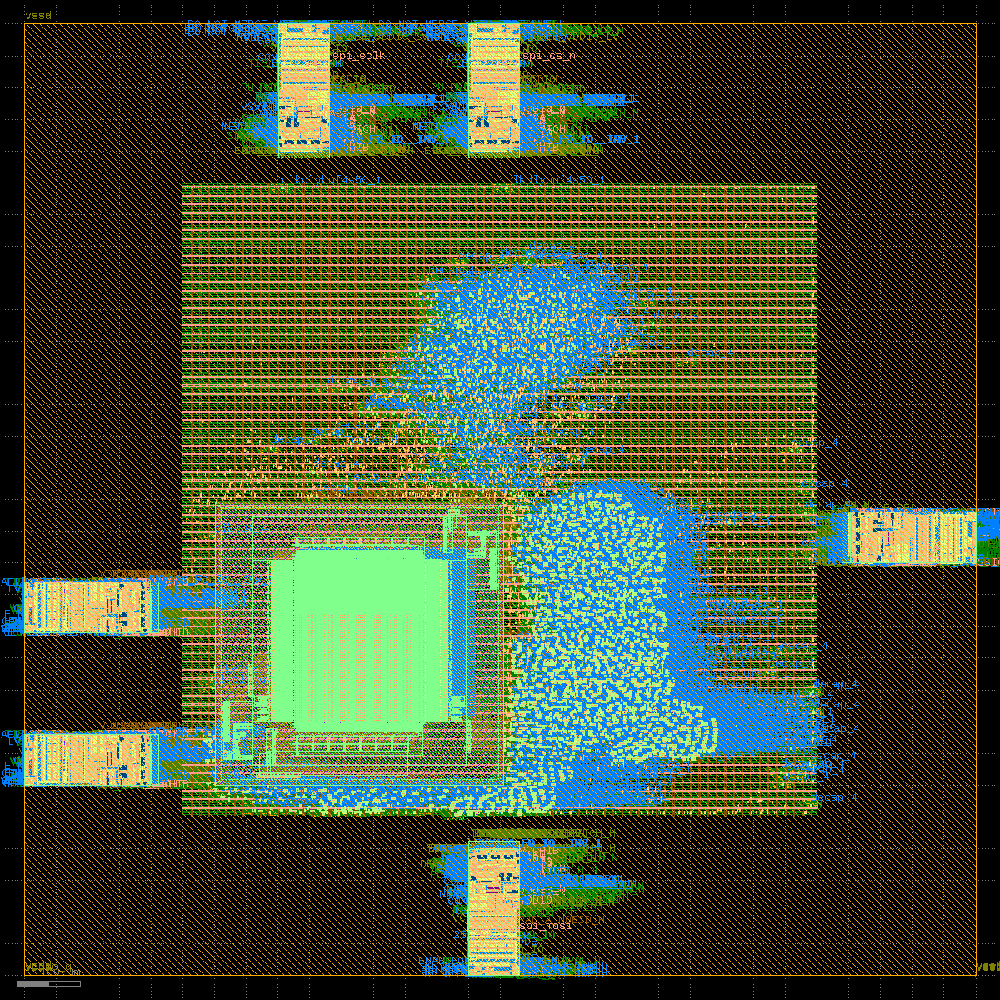

# Project gallery

## Core-only flow screenshots

These screenshots document the earlier RTL-to-GDS core flow. They show the core **without the SRAM macro and without chip-level I/O pad integration**.

| Lint | Synthesis | Synthesis statistics |
|---|---|---|
|  |  |  |

| Core-only floorplan | Core-only placement | Core-only clock-tree synthesis |
|---|---|---|
|  |  |  |

| Core-only route-stage view | Core-only timing analysis | Core-only GDS screenshot |
|---|---|---|
|  |  |  |

## Post-I/O chip preview

The corrected post-I/O run is a separate SRAM-backed chip-wrapper design. The supplied archive contains one GDS preview image plus machine-readable reports and logs; it does not contain separate post-I/O floorplan, placement, CTS, STA, or detailed-route screenshots. The image below is a **global-route preview**, not a completed detailed-route GDS or signoff result.

See the [stage 12 run status](../12_chip_physical/STATUS.md), [QoR summary](../crucible-results/QOR_CHIP_IO.md), and [archived reports and logs](../12_chip_physical/).
